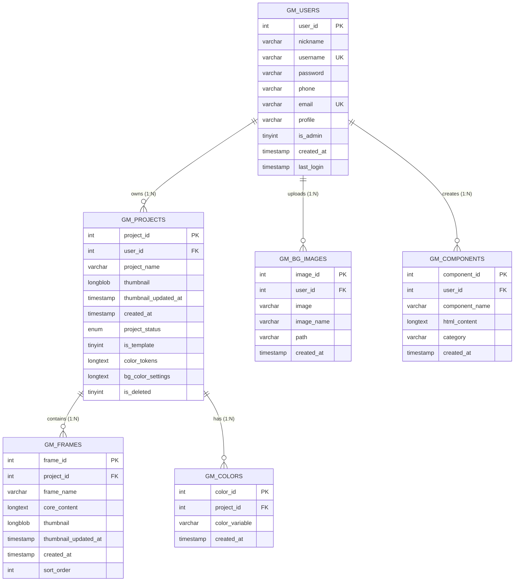

# GREYMIST FRAMEWORK (Versi 1.2) — DOKUMENTASI LENGKAP SISTEM

> **Web-Based Visual Page & UI Builder Platform**  
> *Dokumentasi Teknis, Arsitektur, Struktur Direktori, Skema Basis Data, API, dan Panduan Penggunaan.*

---

## DAFTAR ISI
1. [Ringkasan Eksekutif](#1-ringkasan-eksekutif)
2. [Arsitektur Sistem & Pola Desain](#2-arsitektur-sistem--pola-desain)
3. [Spesifikasi Teknologi & Ketergantungan](#3-spesifikasi-teknologi--ketergantungan)
4. [Alur Kerja Sistem (System Workflows)](#4-alur-kerja-sistem-system-workflows)
5. [Struktur Direktori & Dekomposisi File](#5-struktur-direktori--dekomposisi-file)
   - [A. Berkas Root](#a-berkas-root-)
   - [B. Modul Autentikasi (`/session/`)](#b-modul-autentikasi-session)
   - [C. Portal Pengguna (`/user/`)](#c-portal-pengguna-user)
   - [D. Portal Administrator (`/admin/`)](#d-portal-administrator-admin)
   - [E. Mesin Editor Kanvas (`/part/`)](#e-mesin-editor-kanvas-part)
   - [F. Mesin JavaScript Client (`/assets/JS/`)](#f-mesin-javascript-client-assetsjs)
   - [G. Sistem Atomic CSS Variables (`/assets/GREYMIST_CSS_VAR/`)](#g-sistem-atomic-css-variables-assetsgreymist_css_var)
   - [H. Layanan Backend API (`/api/`)](#h-layanan-backend-api-api)
   - [I. Konfigurasi & Includes (`/config/`, `/includes/`)](#i-konfigurasi--includes-config-includes)
6. [Arsitektur Basis Data (`greymistbeta`)](#6-arsitektur-basis-data-greymistbeta)
7. [Spesifikasi Layanan API REST-Lite](#7-spesifikasi-layanan-api-rest-lite)
8. [Demon Core: Viewport & Responsive Engine](#8-demon-core-viewport--responsive-engine)
9. [Mesin Ekspor Kode (Clean HTML & Pure CSS)](#9-mesin-ekspor-kode-clean-html--pure-css)
10. [Data Akun Default & Pengujian](#10-data-akun-default--pengujian)
11. [Panduan Instalasi & Menjalankan Aplikasi](#11-panduan-instalasi--menjalankan-aplikasi)

---

## 1. Ringkasan Eksekutif

**Greymist Framework** adalah platform pembuat halaman web visual berbasis web (*Web-Based Visual Page Builder*). Platform ini dirancang untuk mempermudah perancangan antarmuka pengguna (UI) secara intuitif melalui manipulasi visual kanvas drag-and-drop, manajemen pohon elemen (DOM Tree), inspeksi gaya CSS secara real-time, dan kemampuan multi-frame/artboard. 

Hasil akhir yang dirancang dalam kanvas Greymist dapat langsung diekspor menjadi kode **Clean Semantic HTML** dan **Responsive Pure CSS** yang terbebas dari markup internal editor, sehingga siap dipublikasikan ke server produksi web manapun.

---

## 2. Arsitektur Sistem & Pola Desain

Greymist menerapkan prinsip **Separation of Concerns (SoC)** dengan memisahkan domain sistem ke dalam modul-modul independen:

```
┌─────────────────────────────────────────────────────────────────┐
│                     USER & ADMIN INTERFACE                      │
│      /user/ (Dashboard, Proyek, Explore) | /admin/ (Moderasi)    │
└────────────────────────────────┬────────────────────────────────┘
                                 │
┌────────────────────────────────▼────────────────────────────────┐
│                    WORKSPACE ENGINE (/index.php)                │
│    Left Panel (DOM/Assets) | Demon Core Canvas | Right Panel     │
└────────────────────────────────┬────────────────────────────────┘
                                 │ AJAX (Fetch / JSON)
┌────────────────────────────────▼────────────────────────────────┐
│                  STATELESS API LAYER (/api/)                    │
│      add_frame.php | save-frame.php | upload-assets-image.php    │
└────────────────────────────────┬────────────────────────────────┘
                                 │ PDO Prepared Statements
┌────────────────────────────────▼────────────────────────────────┐
│                   DATABASE LAYER (MySQL 8.x)                    │
│               Database: greymistbeta (InnoDB)                   │
└─────────────────────────────────────────────────────────────────┘
```

### Karakteristik Desain Utama:
1. **No Heavy Frontend Framework**: Engine editor kanvas dibangun menggunakan **Vanilla JavaScript (ES6+)** tanpa React/Vue. Keputusan ini membebaskan sistem dari *Virtual DOM Diffing Overhead*, menjamin responsivitas instan saat manipulasi kanvas secara *live*.
2. **Atomic CSS Variables System**: Lebih dari 35 file CSS atomik memetakan properti desain menjadi CSS Variables (`--var-name`). Modifikasi gaya di panel kanan langsung mengalir (*cascading*) ke elemen tanpa re-render halaman.
3. **Penyimpanan State Efisien**: Pohon DOM kanvas disimpan sebagai string serialisasi (`LONGTEXT`) pada tabel `gm_frames`, memadukan kecepatan muat data dengan kesederhanaan skema relasional.

---

## 3. Spesifikasi Teknologi & Ketergantungan

- **Bahasa Pemrograman Backend**: PHP 8.3+
- **Database Engine**: MySQL 8.x (Koneksi via PHP Data Objects - PDO)
- **Frontend Core**: HTML5 Semantik, Vanilla JavaScript (ES6+), Vanilla CSS
- **Sistem Desain**: Greymist Atomic CSS Variables System
- **Library Eksternal**:
  - `SortableJS` (v1.15+): Pengurutan layer DOM tree dan frame secara drag-and-drop.
  - `FontAwesome Free 6.7.2`: Katalog ribuan ikon vektor (offline & CDN).
  - `tsparticles` (v2.12.0): Partikel latar interaktif pada halaman autentikasi.
  - `Google Fonts`: Tipografi modern (Plus Jakarta Sans, Inter, Roboto, dll).

---

## 4. Alur Kerja Sistem (System Workflows)

### 4.1 Alur Kerja Pengguna (User Workflow)
1. **Autentikasi**: Pengguna login via `/session/login.php` (verifikasi hash Bcrypt).
2. **Dashboard**: Menuju `/user/dashboard.php` untuk melihat ringkasan aktivitas.
3. **Manajemen Proyek**: Melalui `/user/project.php`, pengguna dapat:
   - Membuat proyek baru (*Untitled Project* dan *Main Frame* otomatis dibuat).
   - Mengubah nama proyek, status publikasi (*published/unpublished*), atau duplikasi proyek.
4. **Editor Kanvas**: Mengklik edit membuka `/index.php?project_id={id}`.
5. **Penyusunan Desain**:
   - Tarik elemen dari panel kiri (Section, Container, Text, Button, Form, Gambar).
   - Atur hirarki di panel *DOM View*.
   - Ubah ukuran, padding, margin, flexbox, grid, font, warna, shadow, dan border di panel kanan.
6. **Simpan & Ekspor**:
   - Simpan otomatis/manual ke database via `/api/save-frame.php`.
   - Buka modal ekspor untuk melihat preview dan menyalin kode HTML/CSS bersih.

### 4.2 Alur Kerja Administrator (Admin Workflow)
1. Admin login secara terpisah di `/admin/login.php` (hanya akun dengan `is_admin = 1`).
2. Masuk ke dashboard `/admin/index.php`.
3. Memantau seluruh proyek pengguna, memeriksa thumbnail, atau membuka preview proyek terisolasi (`/admin/preview_project.php`) tanpa mengganggu state editor aktif.
4. Mengelola pengguna di `/admin/users.php` (ganti peran admin/user, reset password, ban/hapus akun).
5. Mengatur template sistem resmi di `/admin/templates.php`.

---

## 5. Struktur Direktori & Dekomposisi File

### A. Berkas Root (`/`)
- `index.php`: Pintu masuk utama visual editor kanvas. Memvalidasi hak akses proyek, memuat data frame dan warna, menginjeksi komponen HTML editor (`part/`), dan menginisialisasi variabel global frontend `window.GREYMIST`.
- `implementation_plan.md`: Catatan internal pengembangan dan roadmap fitur.
- `docs.md`: Berkas dokumentasi utama platform.

---

### B. Modul Autentikasi (`/session/`)
- `session/login.php`: Formulir login pengguna umum dengan dukungan username/email, divalidasi dengan `password_verify()`.
- `session/register.php`: Pendaftaran akun baru dengan pencegahan duplikasi akun dan enkripsi Bcrypt.
- `session/logout.php`: Mengakhiri sesi pengguna (`session_destroy()`).

---

### C. Portal Pengguna (`/user/`)
- `user/dashboard.php`: Dashboard personal pengguna dengan ringkasan proyek dan analitik akun.
- `user/project.php`: Antarmuka pengelolaan proyek (Buat proyek, ubah nama via AJAX, publish/unpublish, soft delete).
- `user/explore.php`: Katalog proyek publik yang dipublikasikan oleh komunitas.
- `user/templates.php`: Koleksi template starter siap pakai.
- `user/trash.php`: Tempat sampah proyek terhapus (`is_deleted = 1`) dengan opsi *Restore* atau *Delete Permanently*.
- `user/profile.php`: Pengaturan profil (update nama panggilan, email, nomor telepon, dan ganti kata sandi).
- `user/about.php`: Halaman informasi tentang platform Greymist.

---

### D. Portal Administrator (`/admin/`)
- `admin/login.php`: Autentikasi khusus administrator (`is_admin = 1`).
- `admin/logout.php`: Logout sesi administrator.
- `admin/index.php`: Dashboard eksekutif metrik sistem.
- `admin/users.php`: CRUD pengguna, toggle hak admin, dan manajemen kredensial.
- `admin/projects.php`: Pengawasan dan moderasi seluruh proyek pengguna.
- `admin/preview_project.php`: Viewer kanvas terisolasi untuk inspeksi proyek oleh admin.
- `admin/templates.php`: Mengubah status proyek menjadi template resmi platform.
- `admin/settings.php`: Pengaturan global aplikasi yang terhubung ke `config/settings.json`.
- `admin/reports.php`: Laporan dan statistik platform.
- `admin/get_project.php` & `admin/get_user.php`: Endpoint internal penyedia data JSON untuk modal admin.
- `admin/includes/`:
  - `auth.php`: Middleware penjaga sesi admin (`$_SESSION['is_admin'] === true`).
  - `header.php`, `sidebar.php`, `footer.php`: Komponen antarmuka panel admin.

---

### E. Mesin Editor Kanvas (`/part/`)
Direktori yang menyusun antarmuka visual editor:
- `part/CDN.html`: Pemuatan aset eksternal (FontAwesome, fonts, SortableJS, tsparticles).
- `part/style.html`: Stylesheet antarmuka workspace editor.
- `part/script.html`: Orkestrasi urutan eksekusi script JavaScript editor.
- `part/aside-left.html` & `part/aside-left/`:
  - `left-top.html`: Brand logo, editable project title, indikator status penyimpanan.
  - `left-bottom.html`: Navigasi tab panel kiri (Layers, Elements, Assets, Templates).
  - `bottom/DOM-view.html`: Panel penampil pohon hirarki DOM kanvas.
  - `bottom/object.html`: Palet elemen HTML dasar (Div, Section, Container, Button, Typography, Media, Form Elements).
  - `bottom/template.html`: Palet blok template layout siap pakai.
  - `bottom/assets/`: Galeri ikon FontAwesome (`icons.html`), galeri gambar (`image.html`), audio (`audio.html`), dan video (`video.html`).
- `part/main.html` & `part/main/`:
  - `demon-core.html`: **Viewport & Responsive Engine** (Viewport scaling `fitAllCores`, zoom, breakpoint desktop/tablet/mobile/custom, dan generator responsive CSS).
  - `frame/top-slide.html`: Toolbar kanvas (Undo, Redo, Zoom controls, Breakpoints, Preview mode, Ekspor modal).
  - `frame/bottom-slide.html`: Pengalih frame/artboard multi-halaman dalam satu proyek.
  - `frame/attribute/`:
    - `object-attribute.html`: Form atribut elemen (ID, class, href, alt, src, target).
    - `object-action.html`: Event handler interaktif (OnClick: open URL, scroll, toggle modal, show/hide).
    - `object-animation.html`: Pengatur keyframe animasi CSS (Fade, Slide, Bounce, Durasi, Delay).
- `part/aside-right.html` & `part/aside-right/`:
  - `right-top.html`: Tab kategori styling (General, Display, Typography, Box & Colors).
  - `right-bottom/general-menu.html`: Dimensi (Width, Height, Min/Max), Margin, Padding, Position, Offsets, Z-Index.
  - `right-bottom/display-menu.html`: Tipe display (Block, Inline, Flex, Grid, None).
  - `right-bottom/typograph-menu.html`: Kontrol teks (Font family, size, weight, line-height, letter-spacing, alignment, shadow).
  - `right-bottom/box-menu/`: Box model (`box.html`), warna & background (`background.html`), border (`border.html`), bayangan (`box-shadow.html`), outline (`outline.html`), overflow (`overflow.html`), filter visual (`filter.html`), dan hover state (`hover.html`).
- `part/modal.html` & `part/modal/`:
  - `eksport.html`: Generator ekspor kode (Clean HTML, Pure CSS, syntax highlighter, preview tab, copy/download).
  - `display_modal/`: Visual Flexbox Builder (`flex.html`), Visual Grid Builder (`grid.html`), Block (`block.html`), Inline (`inline.html`).
  - `object-menu-modal.html` & `delete-object-modal.html`: Modal opsi cepat dan konfirmasi hapus elemen.
  - `icon-detail.html`: Modal konfigurasi ikon sebelum disisipkan ke kanvas.

---

### F. Mesin JavaScript Client (`/assets/JS/`)
Script editor terbagi berdasarkan fungsinya:
- `object_define/`:
  - `object-define.js`: Definisi cetak biru elemen visual dan konstruksi node kanvas.
  - `object-handler.js`: Penanganan interaksi elemen (seleksi elemen aktif, boundary, drag & resize handle).
  - `clone-object.js`: Duplikasi instan objek kanvas.
- `program_function/`:
  - `component-manager.js`: Manajemen simpan objek kanvas menjadi komponen kustom (Save as Component), rendering daftar komponen, dan drag-and-drop lintas proyek terelasi `user_id`.
  - `main/undo-redo.js`: Riwayat mutasi state kanvas (Undo Ctrl+Z / Redo Ctrl+Y).
  - `main/object-action-runner.js`: Menjalankan aksi interaktif saat mode preview aktif.
  - `main/flex-shortcut.js` & `box-shadow-shortcut.js`: Pintasan manipulasi tata letak dan bayangan.
  - `aside/left/DOM-load.js`: Mengurai DOM kanvas dan merendernya ke panel pohon layer.
  - `aside/right/bg-color.js` & `live-preview.js`: Pemetaan pembaruan warna dan style langsung ke kanvas.
- `right_click_menu/`:
  - `menu-trigger.js`, `menu-actions.js`, `copy-paste.js`, `select-parent.js`, `gm-make-as-link.js`: Menu konteks klik kanan kanvas.
- `user_interface/`:
  - `main/zoom.js`: Perhitungan zoom in, zoom out, dan reset kanvas.
  - `frame/frame-increment.js`: Penambahan artboard frame baru secara dinamis.
  - `aside/render-icon.js`: Pemrosesan dan pencarian 2000+ data ikon FontAwesome.
- `object_behavior/keydown/`:
  - `delete-object.js`: Menghapus elemen terpilih melalui penekanan tombol `Delete` atau `Backspace`.

---

### G. Sistem Atomic CSS Variables (`/assets/GREYMIST_CSS_VAR/`)
Koleksi 35 berkas CSS termodularisasi yang mendefinisikan variabel atomik:
- Dimensi & Spasi: `width.css`, `height.css`, `padding_var.css`, `margin_var.css`, `gap_var.css`, `box_sizing.css`
- Tata Letak: `display_var.css`, `flex_properties_var.css`, `flex_positioning_var.css`, `position_var.css`, `offset_var.css`, `z-index_var.css`, `overflow.css`
- Tampilan Visual: `color_var.css`, `background_color_var.css`, `background_image_var.css`, `border_var.css`, `box_shadow_var.css`, `filter_var.css`, `opacity_var.css`
- Tipografi: `font_family_var.css`, `font_size_var.css`, `font_weight_var.css`, `font_style_var.css`, `text_alignment_var.css`, `text_decoration_var.css`

---

### H. Layanan Backend API (`/api/`)
Daftar seluruh endpoint pemroses data (AJAX/JSON):
- `save_component.php`: Simpan objek aktif dan seluruh child beserta styling inline-nya ke dalam tabel `gm_components` berelasi dengan `user_id`.
- `get_components.php`: Ambil seluruh daftar komponen buatan user untuk dirender pada tab Komponen di semua proyek.
- `delete_component.php`: Hapus komponen kustom milik pengguna.
- `add_frame.php`: Tambah frame baru pada proyek.
- `copy_frame.php`: Gandakan frame beserta seluruh DOM HTML di dalamnya.
- `delete_frame.php`: Hapus frame terpilih.
- `rename_frame.php`: Ganti nama frame.
- `get_frames.php`: Ambil semua frame suatu proyek.
- `save-frame.php`: Simpan string DOM `core_content` dan thumbnail base64/blob.
- `save_cores.php`: Simpan banyak frame secara batch.
- `get_project.php` & `save_project.php`: Ambil dan simpan metadata proyek.
- `rename_project.php`: Ganti nama proyek.
- `get_thumbnail.php`: Ambil gambar thumbnail binary proyek/frame.
- `get_color_tokens.php` & `save_color_tokens.php`: Sinkronisasi token warna CSS typography.
- `get_bg_color_settings.php` & `save_bg_color_settings.php`: Sinkronisasi token variabel dan pengaturan background color proyek.
- `upload-assets-image.php` & `upload-background-image.php`: Unggah gambar aset/background.
- `get-images.php`, `update-image-name.php`, `delete-image.php`: CRUD galeri gambar user.

---

### I. Konfigurasi & Includes (`/config/`, `/includes/`)
- `config/settings.json`: File konfigurasi aplikasi (nama situs, status registrasi, batasan unggahan).
- `includes/db.php`: Singleton koneksi database PDO ke MySQL `greymistbeta`.
- `includes/auth.php`: Middleware penjaga sesi login user (`$_SESSION['user_id']`).
- `includes/header.php` & `includes/footer.php`: Template navigasi umum untuk portal user.

---

## 6. Arsitektur Basis Data (`greymistbeta`)

Database `greymistbeta` menggunakan mesin penyimpanan **InnoDB** dengan charset **utf8mb4**:



### Relasi & Integritas Referensial (Foreign Keys):
1. `fk_projects_user`: `gm_projects(user_id) REFERENCES gm_users(user_id) ON DELETE CASCADE`
2. `fk_frames_project`: `gm_frames(project_id) REFERENCES gm_projects(project_id) ON DELETE CASCADE`
3. `fk_colors_project`: `gm_colors(project_id) REFERENCES gm_projects(project_id) ON DELETE CASCADE`
4. `fk_bg_user`: `gm_bg_images(user_id) REFERENCES gm_users(user_id) ON DELETE CASCADE`
5. `fk_components_user`: `gm_components(user_id) REFERENCES gm_users(user_id) ON DELETE CASCADE`

---

## 7. Spesifikasi Layanan API REST-Lite

Semua permintaan API menggunakan format **JSON** atau **Form-Data** dengan balasan JSON terstruktur:

| Endpoint | Method | Parameter Utama | Output Respon | Keterangan |
| :--- | :--- | :--- | :--- | :--- |
| `/api/add_frame.php` | `POST` | `project_id`, `frame_name` | `{"success": true, "frame_id": 12}` | Menambahkan frame baru |
| `/api/save-frame.php` | `POST` | `frame_id`, `core_content`, `thumbnail` | `{"success": true}` | Menyimpan HTML kanvas & thumbnail |
| `/api/copy_frame.php` | `POST` | `frame_id` | `{"success": true, "new_frame_id": 13}` | Duplikasi frame & DOM kanvas |
| `/api/delete_frame.php`| `POST` | `frame_id` | `{"success": true}` | Hapus frame |
| `/api/get_frames.php` | `GET` | `project_id` | `[{"frame_id": 1, "frame_name": "Main", ...}]` | Daftar seluruh frame proyek |
| `/api/save_color_tokens.php` | `POST` | `project_id`, `color_tokens` | `{"success": true}` | Simpan token variabel warna |
| `/api/upload-assets-image.php` | `POST` | `file` (image/png, jpeg, webp) | `{"success": true, "url": "..."}` | Unggah aset gambar pengguna |

---

## 8. Demon Core: Viewport & Responsive Engine

Komponen **Demon Core** ([part/main/demon-core.html](file:///c:/laragon/www/Greymist%20%28version%201.2%29/part/main/demon-core.html)) menjalankan 3 tugas utama:

1. **Responsive Breakpoints Engine**:
   - `Desktop`: Base layout (1920px).
   - `Tablet`: Max-width 1024px.
   - `Mobile`: Max-width 480px.
   - `Custom Breakpoints`: Disimpan per proyek di `localStorage`, mendukung aturan `min-width` maupun `max-width`.
2. **Auto-Calibration (`fitAllCores`)**:
   - Menghitung rasio `wrapper.clientWidth / targetWidth` dan mengaplikasikan `transform: scale(...)` sehingga kanvas selalu proporsional dan tidak terjadi layout clipping terlepas dari resolusi layar perangkat yang digunakan oleh desainer.
3. **Dynamic Responsive CSS Compiler (`generateResponsiveCSS`)**:
   - Mengumpulkan data inline style per breakpoint (`data-bp-desktop`, `data-bp-tablet`, `data-bp-mobile`) dari setiap elemen `[data-gm-id]` dan merangkumnya menjadi aturan `@media (...)` yang bersih secara live.

---

## 9. Mesin Ekspor Kode (Clean HTML & Pure CSS)

Modul [part/modal/eksport.html](file:///c:/laragon/www/Greymist%20%28version%201.2%29/part/modal/eksport.html) membersihkan markup kanvas editor sebelum disajikan kepada pengguna:

1. **Pembersihan Markup Editor**:
   - Menghapus kelas-kelas internal editor (`gm-object`, `gm-active-object`, `ui-resizable-handle`, dll).
   - Menghilangkan atribut internal seperti `data-gm-id`, `data-bp-*`.
2. **Kompilasi Stylesheet**:
   - Mengonversi inline styles menjadi blok class CSS yang terorganisir.
   - Menyertakan aturan media queries responsif yang telah disusun oleh *Demon Core*.
3. **Format Siap Pakai**:
   - Disediakan dalam bentuk tab pratinjau interaktif, tombol *Salin ke Clipboard*, dan opsi unduh paket web mandiri.

---

## 10. Data Akun Default & Pengujian

Telah disediakan akun dummy aktif yang dapat digunakan untuk pengujian:

| Role | Username | Password | Email | Status Akses |
| :--- | :--- | :--- | :--- | :--- |
| **Regular User** | `nasuha` | `nasuha123` | `nasuha@greymist.com` | Portal User (`/user/dashboard.php`) |
| **Administrator** | `greymist` | `greymist123` | `admin@greymist.com` | Portal Admin (`/admin/index.php`) & Portal User |

*Catatan: Seluruh kata sandi dienkripsi dengan standar PHP `PASSWORD_DEFAULT` (Bcrypt).*

---

## 11. Panduan Instalasi & Menjalankan Aplikasi

1. **Persyaratan Sistem**:
   - Web Server: Apache atau Nginx (Direkomendasikan menggunakan **Laragon** pada Windows).
   - PHP: Versi 8.1 ke atas dengan ekstensi `pdo_mysql`, `mbstring`, `fileinfo` aktif.
   - Database: MySQL versi 8.0+.

2. **Langkah Pemasangan**:
   - Tempatkan folder proyek di direktori web root server, contoh: `C:\laragon\www\Greymist (version 1.2)`.
   - Buka phpMyAdmin atau MySQL CLI, buat database baru:
     ```sql
     CREATE DATABASE greymistbeta CHARACTER SET utf8mb4 COLLATE utf8mb4_general_ci;
     ```
   - Impor skema basis data dari berkas:
     ```bash
     DB/greymistbeta.sql
     ```
   - Pastikan konfigurasi koneksi di [includes/db.php](file:///c:/laragon/www/Greymist%20%28version%201.2%29/includes/db.php) sesuai:
     ```php
     $host = "localhost";
     $db   = "greymistbeta";
     $user = "root";
     $pass = "";
     ```

3. **Mengakses Aplikasi**:
   - Halaman Utama / Login User: `http://localhost/Greymist%20(version%201.2)/session/login.php`
   - Halaman Login Administrator: `http://localhost/Greymist%20(version%201.2)/admin/login.php`
   - Dokumentasi Interaktif Sistem: `http://localhost/Greymist%20(version%201.2)/docs/index.html`

---
*Dokumentasi ini dibuat dan disinkronkan secara otomatis untuk **Greymist Framework v1.2**.*
